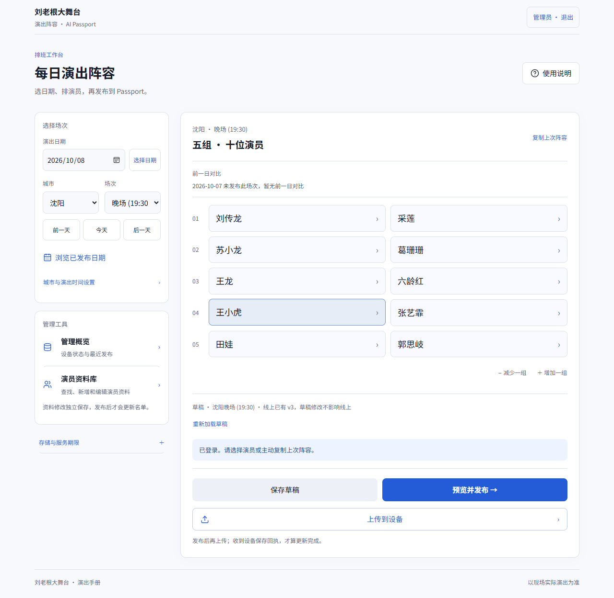

<p align="center"></p>
[简体中文](README.md)

<p align="center"><a href="https://github.com/YUEB1NG/liulaogen/actions/workflows/checks.yml"></a> <a href="LICENSE"></a> </p>

# liulaogen

**A familiar stage, in your pocket.**

A cast-lineup handbook for FoloToy AI Passport, with open-source ESP32-C3 firmware and a mobile management website. Pair over Wi-Fi, select a published date, upload the lineup and confirm its saved receipt.

Open website · r5 preview firmware · Hosting guide · Verification record

[Open website](https://quyue.pythonanywhere.com)

[r5 preview firmware](https://github.com/YUEB1NG/liulaogen/releases/tag/v0.2.0-liulaogen-wifi-r5)

[Hosting guide](docs/hosting.md)

[Verification record](docs/status.md)


| Pocket handbook | Mobile management | Explicit synchronization |
| --- | --- | --- |
| Eight-city interface, historical records and button navigation | Actor profiles, date selection and published lineups | Pair, select, upload and confirm the saved receipt |
| Synced content supports offline reading | Python standard-library backend | Sending a job is not treated as proof of storage |

## Updated interface

r6 firmware is built and verified locally, with physical-device acceptance pending. The website adds an overview, date shortcuts, frozen published introductions and transitions. See validation records for deployment status.

[r6 interface and validation](docs/r6-interface.md)

[Design sources and licenses](docs/design-sources.md)

Local test lineups, not a real performance schedule



## Quick start

```sh
git clone https://github.com/YUEB1NG/liulaogen.git
cd liulaogen/website
python server.py
```

Open `http://127.0.0.1:8766`. Initial credentials are stored locally in `runtime/credentials.json`; never commit or publish this file.

See the hosting guide for deployment. The hosted demo uses PythonAnywhere; GitHub Pages cannot execute the Python backend. Free hosting requires renewal through the provider's dashboard. Hosting status and its last verification date are recorded in verification status.

[hosting guide](docs/hosting.md)

[verification status](docs/status.md)


## Usage and API

The [HTTP API guide](docs/API.md) covers authentication, public reads, draft/publication versions and device saved receipts. With the server running, this standard-library example reads public metadata without changing content:

```sh
python website/examples/read_public_api.py
```

Run from the repository root. In the website, log in using local credentials, select a date, save and preview the draft, publish, then explicitly upload to a paired online device. Publication alone does not deliver content. See [contribution guidance](CONTRIBUTING.md) for checks and bug reports.

## From website to device


## Firmware and hardware

| Item | Configuration |
| --- | --- |
| Firmware | r5 preview release |
| Chip | ESP32-C3 |
| Storage | 8 MB Flash / no PSRAM |
| Toolchain | Native ESP-IDF 5.5.3 |
| Download | Merged BIN and matching ELF / MAP |

Read the firmware instructions and build verification guide before flashing. The verified merged image belongs at **0x0** and resets stored configuration/cache. Do not substitute the application-only BIN or perform a whole-chip erase.

[firmware instructions](firmware/docs/development/cast-wifi.md)

[build verification guide](firmware/docs/development/engineering/build-and-test.md)


## Verification boundaries

The October 8, 2026 r5 record reports successful build and host checks, flashing and independent device verification. User acceptance reported normal display, responsive buttons and no obvious startup flicker. Website upload/saved receipt, offline biographies, power-loss durability and real iPhone Safari acceptance remain pending.

r5 changes · Full verification record

[r5 changes](docs/r5-update.md)

[Full verification record](docs/status.md)


<details>
<summary><b>Source layout and development checks</b></summary>

- `firmware/`: application, BSP, font assets, tests and build tools
- `website/`: Python backend and mobile frontend
- `website/deploy/pythonanywhere_wsgi.py`: WSGI hosting template

Inside `website/`:

```sh
python -m unittest -v test_api test_device_link test_hosted test_wsgi test_features
```

From `firmware/` in an activated ESP-IDF environment, run `tools/validate.ps1 --all` on Windows or `bash tools/validate.sh` on a supported POSIX environment. Source CI and physical-device acceptance are tracked separately.

</details>

## Licensing and provenance

Project code is MIT, Noto fonts retain SIL OFL, and original FoloToy and third-party notices remain intact. See licenses. This community derivative is not an official FoloToy release; historical records are not today's performance lineup.

[MIT](LICENSE)

[licenses](docs/licenses.md)


Accounts, tokens, Wi-Fi credentials, private runtime data, toolchains and raw device logs are excluded from this repository.

---

By YUEB1NG · Also see zibian

[YUEB1NG](https://github.com/YUEB1NG)

[zibian](https://github.com/YUEB1NG/zibian)
