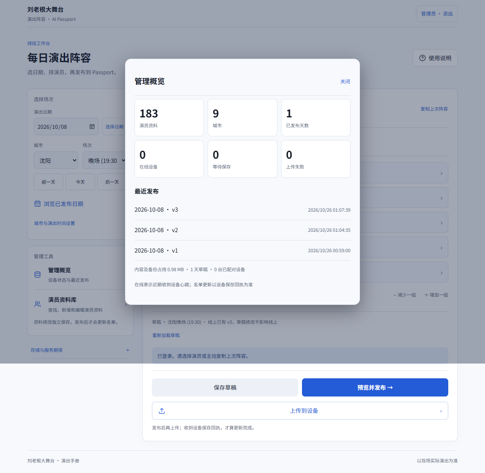

[English](r6-interface.md)

# r6 界面验收

r6 源码和界面截图已上传 GitHub。由于本机无法与 PythonAnywhere 建立 TLS 连接，线上网站更新暂未完成。r5 仍是用户已验收的硬件版本，r6 尚未烧录。

- 统一浅色界面和自托管字体，使用本地 Lucide 图标，支持减少动态效果
- 前一天、后一天、今天快捷切换，已发布日期、已发布演员简介和手机使用说明
- 管理概览显示实际资料数量、设备上传状态和最近发布记录
- 静态资源传输不再占用业务锁；设备状态不变时保留控件与焦点
- 固件保留八城布局与每行 13 字，只调整配色、跳过相同文字的重复写入

后端 62 项测试通过。浏览器覆盖 320、390、768、1280 像素宽度，检查日期对齐、搜索不自动聚焦、艺名搜索、城市时间编辑、设备批量操作与备注、发布隔离、错误提示、管理概览、公开简介和减少动态效果。使用 Edge 触摸模拟；真实 iPhone 与 r6 实机尚未测试。

固件验证包括原生 ESP-IDF 5.5.3、应用主机测试、中文覆盖、LVGL 字形运行时检查、合并镜像验证及匹配 ELF/MAP 归档。静态门禁有 21 项平台相关跳过，不能把这些测试当作真实无线电验证。

合并镜像地址为 0x0，会重置其包含分区内的配置与缓存。须保留匹配调试归档；新烧录需要明确批准。

## 重现浏览器检查

在 8775 端口启动本地服务器，使用全新的独立测试数据目录。在项目内安装 Playwright 并设置 NODE_PATH；LIULAOGEN_TEST_DATA 指向该测试目录，LIULAOGEN_TEST_OUTPUT 指向报告目录，可用 LIULAOGEN_BROWSER 指定 Chromium 浏览器。运行 node website/tests/browser.cjs。测试会修改本地测试数据，不能指向真实运行目录。

管理概览截图（测试数据）

